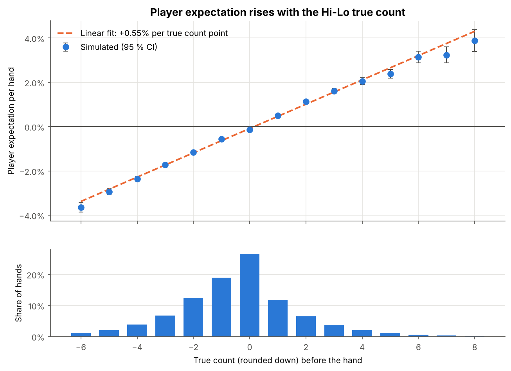

# Blackjack Monte Carlo Engine

[](https://github.com/mtoralv/blackjack-montecarlo-engine/actions/workflows/ci.yml)

Blackjack simulator in plain Java (no dependencies) plus a Jupyter notebook to analyse the results. It started as a terminal Blackjack game and ended up as a way to test strategies, card counting and betting systems over millions of hands.

Default rules: 6 decks, dealer stands on soft 17, blackjack pays 3:2, double after split, late surrender, reshuffle at 75 %. All of it can be changed from the command line.



## Results

| Playing | Betting | House edge | Player return |
|---|---|---:|---:|
| Basic strategy | Flat | 0.37 % | −0.37 % |
| Basic strategy | Hi-Lo (1-12 spread) | 0.37 % | +0.09 % |
| Basic strategy | Martingale | 0.37 % | −0.48 % |
| Basic strategy | Oscar's Grind | 0.37 % | −0.54 % |
| Basic strategy | 1-3-2-6 | 0.37 % | −0.39 % |
| Hit below 17 | Flat | 5.68 % | −5.68 % |
| Never hit | Flat | 15.99 % | −15.99 % |
| Random | Flat | 29.84 % | −29.84 % |
| Always hit | Flat | 64.40 % | −64.40 % |

House edge = expected loss per initial bet. Player return = total profit / total bet, which is the only thing bet sizing can change.

- Basic strategy gives 0.37 %, which matches published numbers for these rules, so the engine works.
- Hi-Lo counting makes the game slightly positive, more with deeper penetration.
- Betting systems don't change the return, they only change the risk: with a 100 unit bankroll, 97 % of Martingale players go broke within 5,000 hands.
- A 6:5 payout takes the house edge from 0.37 % to 1.74 %.

More plots and details in the [notebook](notebooks/blackjack_analysis.ipynb).

## How to run

Needs Java 21+.

```bash
./run.sh                 # run all strategies, CSVs go to results/
./run.sh play            # play in the terminal (? gives a hint)
./run.sh test            # tests
./run.sh help            # all options
```

On Windows use `run.bat`. Some examples:

```bash
./run.sh simulate --play basic --bet flat,hilo --sims 2000 --hands 20000 --h17
./run.sh simulate --bet flat,martingale,oscar,1326 --bankroll 200 --out results/ruin
```

For the notebook:

```bash
pip install -r requirements.txt
jupyter notebook notebooks/blackjack_analysis.ipynb
```

## Code

```
src/
├── Main.java          command line
├── game/              rules: cards, hands, shoe, table (dealer, splits, doubles, surrender)
├── strategy/
│   ├── playing/       basic strategy and the naive ones
│   └── betting/       flat, Hi-Lo, Martingale, Oscar's Grind, 1-3-2-6
├── simulation/        Monte Carlo, stats and CSV output
└── console/           terminal game
test/                  tests
notebooks/             analysis
```

Playing and betting strategies are separate, so any combination can be simulated. The terminal game is just another playing strategy that reads from the keyboard, so it uses the same engine as the simulations.

## TODO

- [ ] Paroli, D'Alembert, Fibonacci and Labouchère
- [ ] Other counting systems (KO, Omega II) and Hi-Lo index plays / insurance
- [ ] Composition-dependent strategy and single deck charts
- [ ] Find the best strategy by simulation instead of hardcoding the chart
- [ ] Kelly bet sizing
- [ ] Several players at the same table
